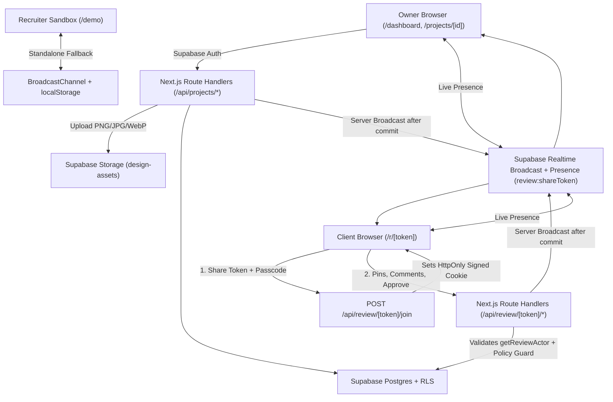

# System Architecture — SignOff

## 1. High-Level Topology

---

## 2. Next.js App Router Structure
- `/` — Marketing landing page + clear CTA to `/demo` and `/login`
- `/login` — Freelancer sign-in / sign-up (Email/Password + Magic Link)
- `/dashboard` — Protected owner project list & quick project creation
- `/projects/[id]` — Owner workspace (version manager, upload modal, share link & passcode controls, live review canvas)
- `/r/[token]` — Zero-login Client Review Room (guest name/passcode gate → canvas + threads + Before/After + Approve)
- `/settings` — Owner account: studio name (shown to clients), email, password, sign out everywhere, delete account
- `/demo` — Standalone interactive portfolio sandbox (`v1` & `v2` sample project, cross-tab `BroadcastChannel('signoff-demo')` sync)

### 2a. Frontend Component Architecture (Atomic Design)
UI components under `src/components/` follow **Atomic Design**:
- `src/components/atoms/` — Indivisible UI primitives & indicators (`StatusBadge`, `PresenceAvatars`, `ConnectionBanner`)
- `src/components/molecules/` — Focused multi-element composites, dialogs, and upload/share forms (`ConfirmDialog`, `ApprovalDialog`, `RecordApprovalDialog`, `DeleteProjectDialog`, `CopyWaSummaryModal`, `SharePanel`, `CreateProjectModal`, `VersionUploadModal`, `SessionExpiredModal`, `ShortcutHelpModal`)
- `src/components/organisms/` — Interactive feature sections (`OwnerHeader`, `DesignCanvas`, `BeforeAfterSlider`, `ThreadSidebar`)
- `src/components/templates/` — Full workspace composition shells (`ReviewWorkspace`)
- `src/components/providers/` — Application context providers (`ToastProvider`)
- `src/app/**/page.tsx` — **Pages**: fetch data, enforce auth/session gates, and wire API or `/demo` handlers into Templates, Organisms, and Molecules.

Dependency rule: imports flow strictly downward (`Pages` → `Templates` → `Organisms` → `Molecules` → `Atoms`).

---

## 3. API Route Contracts

### Owner Endpoints (Require Authenticated Supabase User + Project Ownership)
| Method & Path | Purpose | Notes |
|---|---|---|
| `GET /api/projects` | List projects owned by current user | Includes version & open-pin summary counts, plus `newFeedbackCount` (submitted client pins + client comments created after `owner_last_viewed_at`) |
| `POST /api/projects` | Create new project | Generates high-entropy `share_token`; hashes optional passcode |
| `PATCH /api/projects/[id]` | Update title, client name, passcode, `review_due_at`, or archive state (`archived: true/false`) | Owner only. Archiving logs `project_archived` / `project_unarchived` |
| `DELETE /api/projects/[id]` | Permanently delete a project | Body `{ confirmTitle }` must equal the project title (trimmed), else `400`. Deletes every Storage object under `projects/{projectId}/` first, then the row (children cascade). Irreversible |
| `POST /api/projects/[id]/seen` | Mark project as viewed by owner | Sets `owner_last_viewed_at = now()`; called when `/projects/[id]` opens (resets the New Feedback Badge) |
| `POST /api/projects/[id]/versions` | Upload new version (`v1`, `v2`, ...) + frames | Validates MIME (`png/jpeg/webp`) & size (`<= 10 MB`); logs `version_uploaded`; broadcasts `version_created` |
| `PATCH /api/projects/[id]/versions/[versionId]` | Set version status to `changes_requested` (or back to `in_review`), edit notes | Owner only; cannot modify an `approved` version; logs `changes_requested` |
| `PATCH /api/projects/[id]/versions/[versionId]/frames` | Rename frames and/or reorder them | Body `{ frames: [{ id, title?, sortOrder? }] }`. Allowed on any version, including approved. Adding or removing frames is NOT supported: that happens only by uploading a new version |
| `POST /api/projects/[id]/versions/[versionId]/record-approval` | Owner records an approval the client gave outside SignOff | Body `{ clientName, source: 'whatsapp' \| 'email' \| 'meeting' \| 'other', note? }`. Same rules as client approve (latest version, `in_review`). Stores `approval_method = 'owner_recorded'`; the statement reads *"Dicatat oleh {owner} berdasarkan ACC dari {clientName} via {source}."*; broadcasts `version_approved` |
| `GET /api/account` · `PATCH /api/account` | Read or update the owner profile (`studio_name`) | Owner only. Email and password changes use Supabase Auth directly from the client |
| `DELETE /api/account` | Delete the owner account | Body `{ confirmEmail }`. Deletes all projects (as above), the profile, then the auth user via the admin client. Irreversible |
| `POST /api/projects/[id]/rotate-token` | Generate a new `share_token` | Old `/r/[token]` links, guest cookies and Realtime channel stop working; logs `share_token_rotated` |

### Review Endpoints (Require Owner Session OR Valid Guest Cookie for `token`)
| Method & Path | Purpose | Notes |
|---|---|---|
| `POST /api/review/[token]/join` | Verify passcode (if set) & guest name | Rate limited via `join_attempts`: 5 failed attempts per IP + project per 15 min → `429`. Issues `HttpOnly` HMAC cookie (`signoff_guest_<projectId>`) |
| `GET /api/review/[token]` | Fetch sanitized review state | Excludes `passcode_hash`; issues signed image URLs with **1-hour TTL** (client re-fetches this endpoint when URLs expire) |
| `POST /api/review/[token]/pins` | Create Pin (`point` or `box`) + first comment | Runs `assertCanCreatePin()`, assigns `pin_number` via Postgres function `create_pin(...)`. Owner pins are submitted immediately and broadcast `pin_created`. Client pins are saved as **drafts** (`submitted_at = NULL`) and are NOT broadcast |
| `POST /api/review/[token]/pins/submit` | Submit all of the caller's draft pins | Sets `submitted_at = now()` on the caller's drafts (matched by `author_session_id`); re-checks `assertCanCreatePin()`. Drafts on an older, non-approved version are still accepted (the UI warns first); the response lists, per version, how many were submitted; logs one `feedback_submitted` (with count); broadcasts `pin_created` per pin |
| `DELETE /api/review/[token]/pins/[pinId]` | Delete a pin | **Client:** only their own drafts (`submitted_at IS NULL`, `author_session_id` matches). **Owner:** any pin on a non-approved version; logs `pin_deleted` (with pin number and first comment) and broadcasts `pin_deleted`. Otherwise `403` / `409` on approved versions |
| `PATCH /api/review/[token]/pins/[pinId]` | Update status (`open`, `in_progress`, `resolved`) or category | **Owner:** any status, any category. **Client:** only on their own submitted pins (`author_session_id` matches), only `in_progress`/`resolved` → `open` (reopen) and category; anything else `403`. `409` on approved versions. Logs `pin_status_changed` / `pin_resolved`; broadcasts `pin_updated` |
| `PATCH /api/review/[token]/comments/[commentId]` | Edit own comment | Author only (owner: `author_role = 'owner'`; client: `author_session_id` matches). Sets `edited_at`. `409` on approved versions. Broadcasts `comment_updated` |
| `DELETE /api/review/[token]/comments/[commentId]` | Delete own comment | Author only. Soft delete: sets `deleted_at`, clears `body`; the thread shows "Komentar dihapus". Deleting a pin's first comment keeps the pin. `409` on approved versions. Logs `comment_deleted`; broadcasts `comment_updated` |
| `POST /api/review/[token]/pins/[pinId]/comments` | Add reply to pin thread | Validates non-empty body; replies only allowed on submitted pins (`409` on drafts); logs `comment_added`; broadcasts `comment_created` |
| `POST /api/review/[token]/versions/[versionId]/approve` | Lock version as `approved` | **Client only** (an owner gets `403` and uses `record-approval`). Body: `{ confirmName, agreed: true }`. Stores `approval_method = 'client_link'`. `confirmName` must match the server-derived actor name (trimmed, case-insensitive), else `400`. Only the **latest** version with status `in_review` can be approved, otherwise `409`. Server builds `approval_statement` from a fixed template, records `approved_by_name` + `approved_at` + `approval_statement`; broadcasts `version_approved` |

All mutation endpoints (owner and review) broadcast their event **after** the database write commits (see §5). The frames endpoint broadcasts `frames_updated`; archiving and unarchiving broadcast `project_archived` with `{ archived: true | false }`.

**Archived projects:** `/r/[token]` stays readable, but every review mutation (pins, comments, status, approve, submit) returns `409` with reason `archived` until the owner unarchives. `assertCanCreatePin()` also rejects archived projects.

---

## 4. Normalized Coordinate System (`src/lib/canvas/coordinates.ts`)
- All coordinates are stored relative to the image container's rendered bounding box in `[0.0, 1.0]`:
  - `x_norm = clamp((clientX - rect.left) / rect.width, 0, 1)`
  - `y_norm = clamp((clientY - rect.top) / rect.height, 0, 1)`
- **Area Box Drag Normalization:** Dragging in any direction (right-to-left, bottom-to-top) normalizes `x_norm = min(x1, x2)`, `y_norm = min(y1, y2)`, `w_norm = abs(x2 - x1)`, `h_norm = abs(y2 - y1)`. If `w_norm < 0.015 && h_norm < 0.015`, treat accidental micro-drag as a `point` pin or cancel.
- **Zoom & Pan:** Zoom (`0.5` to `3.0`) wraps the canvas content inside a single transform layer so `getBoundingClientRect()` on the inner image surface automatically accounts for zoom & pan offsets.

---

## 5. Realtime Synchronization
- **Why not `postgres_changes`:** It enforces RLS `SELECT`. Guests have no Supabase session and anon reads are blocked, so guests would receive nothing. SignOff therefore uses **server-sent Realtime Broadcast** only.
- **Channel Naming:** `review:${shareToken}`. The topic is unguessable, and knowing the token already grants review access. Rotating `share_token` kills the old channel automatically.
- **Server Broadcast:** After a mutation commits, the Route Handler sends the event through the server-only admin client. Clients NEVER write to the database through Realtime.
- **Events:** `pin_created`, `pin_updated`, `pin_deleted`, `comment_created`, `comment_updated`, `version_created`, `version_approved`, `frames_updated`, `project_archived`. Payloads are sanitized and use the same shapes returned by `GET /api/review/[token]` (no `passcode_hash`, no `owner_id`).
- **Presence Payload:** `{ actorName, role: 'owner' | 'client', activeFrameId, joinedAt }`. Owner and guests join the same channel for Broadcast + Presence.
- **Drafts:** Draft pins are never broadcast. They appear to others only after `/pins/submit`.
- **Idempotent Reconciliation:** Client state merges incoming events by `id`, so optimistic updates never produce duplicate pins or comments.
- **`/demo` Parity:** Uses `BroadcastChannel('signoff-demo')` + `localStorage` so recruiters can test two-tab sync offline or without Supabase credentials.
