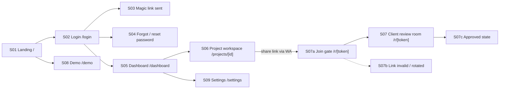

# Screen Inventory & Edge Cases — SignOff (MVP)

The complete list of pages, overlays and states to design. Each screen has an ID (`S01`, `O03`, …) so designs, tickets and code can refer to it.
Features, rules and API behaviour come from `PRD.md`, `ARCHITECTURE.md`, `SECURITY_AND_AUTH.md` and `UI_UX_GUIDELINES.md`. Visual identity comes from `BRANDING.md`. If this file disagrees with those docs, those docs win, and this file should be fixed.

**Breakpoints to design:** desktop `1440`, laptop `1280`, tablet `768`, phone `390`, plus a `320` check for overflow.
**Actors:** `Owner` (signed-in freelancer), `Client` (guest via `/r/[token]`), `Visitor` (not signed in), `Recruiter` (on `/demo`).

---

## 0. States every screen must have

Unless a screen says otherwise, each one needs a design for:

| State | What it means |
|---|---|
| **Loading** | First load. Use a skeleton shaped like the real layout, never a centred spinner on a blank page. |
| **Empty** | No data yet, with one clear next action. |
| **Populated** | Normal content. |
| **Extreme content** | Very long names and titles, 100+ items, emoji, a single item. |
| **Error** | The request failed: what happened, and a retry. |
| **Offline / reconnecting** | Network lost or Realtime disconnected (see `G04`). |
| **No permission** | Wrong account, or a link that no longer grants access. |

---

## 1. Screen map

---

## 2. Global elements (G)

| ID | Element | Notes and edge cases |
|---|---|---|
| `G01` | **Owner app header** | Lockup (left), project name/breadcrumb, account menu (studio name or email, Pengaturan, Keluar). Mobile: mark only + menu. A very long email truncates in the middle (`budi…@gmail.com`). |
| `G02` | **Toasts** | Success (link copied, summary copied, feedback sent), error (with retry), info. At most one at a time; stack at most 2. On mobile, sits above the bottom bar, never covering the Approve button. |
| `G03` | **Confirm dialog** | Only for destructive or irreversible actions: rotate token, approve, delete draft pin. Never for ordinary saves. |
| `G04` | **Connection banner** | Three states: "Menyambung ulang…" (Realtime lost, retrying), "Kamu sedang offline, perubahan belum terkirim" (no network), "Tersambung lagi" (auto-hides after 3 s). Unsent actions are kept and retried; designs must show which pin or comment is still pending. |
| `G05` | **404** | Page not found. Links to Beranda and, if signed in, Dashboard. |
| `G06` | **500 / unexpected error** | Calm wording, a retry button, and a short error reference code the user can send to support. |
| `G07` | **Session expired (owner)** | The owner's Supabase session ended mid-work. Show a modal with "Masuk lagi" that returns to the same page; unsent text stays in place. |
| `G08` | **Unsupported browser** | Very old browsers (no `BroadcastChannel`, no `fetch`). Show a one-line notice, and keep reading pins possible where it can. |
| `G09` | **Keyboard shortcut sheet** (`?`) | Desktop only. Lists `P`, `B`, `Space`, `N` / `Shift+N`, `R` (owner), `Esc`, `?`. |

---

## 3. Public pages

### `S01` Landing page — `/`
**Who:** Visitor. **Goal:** understand SignOff in seconds, then try `/demo` or sign up.

- **Sections:**
  - Hero: tagline, a short explanation, primary action "Coba demo", secondary action "Masuk / Daftar".
  - How it works: pin → komentar → ACC.
  - Feature proof: real UI pieces (canvas with pins, Before/After slider, Approve dialog, WA summary).
  - Why it beats WhatsApp feedback.
  - Closing call to action and footer.
- **Edge cases:**
  - A signed-in owner sees "Buka Dashboard" instead of "Masuk".
  - With reduced motion, every demo animation rests in a finished state.
  - No pricing, customers, testimonials or numbers may be invented (`PRODUCT.md`, Evidence).
  - At `320`, the hero text and the button must fit without sideways scrolling.

### `S02` Login / Sign up — `/login`
**Who:** Visitor.

- **Tabs or toggle:** Masuk / Daftar. Methods: email + password, or "Kirim magic link".
- **States:**
  - Idle
  - Submitting (button busy, fields locked)
  - Wrong email or password, shown as one generic message that never says which one is wrong
  - Email not confirmed yet, with a resend link
  - Email already registered on sign-up
  - Password too weak, with the rule shown before submitting
  - Too many attempts (Supabase rate limit): wait message with the time remaining
  - Supabase down: `G06` style message
- **Edge cases:**
  - Already signed in: redirect to `/dashboard`.
  - Arriving with `?next=/projects/…`: return there after login.
  - Paste with trailing spaces in the email field is trimmed.
  - The password manager autofill layout must not break.

### `S03` Magic link sent
- Shows the address used, a "Kirim ulang" button with a cooldown (e.g. 60 s), and a "Salah email?" link.
- **Edge cases:**
  - The magic link is opened on a different device or browser: it signs in there, and the original tab keeps waiting. Show a note on this screen.
  - The link is expired or already used: dedicated error with "Kirim link baru".

### `S04` Forgot / reset password
- Two steps:
  1. Enter email, then "Cek email kamu" (always the same message, whether or not the account exists).
  2. Set new password, from the email link.
- **Edge cases:**
  - Expired or used reset link.
  - New password equal to the old one, or too weak.
  - Success signs the user in and goes to `/dashboard`.

---

## 4. Owner pages

### `S05` Dashboard — `/dashboard`
**Who:** Owner. **Goal:** see every project and where it stands; create a new one.

- **Project row/card content:**
  - Title and client name
  - Latest version label (`v3`)
  - Status (`in_review` / `changes_requested` / `approved`)
  - Open pin count
  - New Feedback Badge (`3 baru`)
  - Review deadline (if set)
  - Last activity time
- **Actions:**
  - "Proyek baru" opens `O01`.
  - Clicking a project opens `S06`.
  - Row menu: "Arsipkan" (or "Kembalikan" in the archive view), "Hapus permanen" (`O09`).
- **Views:** "Aktif" (default) and "Arsip". Archived rows show the archive date and a read-only tag.
- **States:**
  - **First-time empty:** no projects. Explain the three steps (upload → share → ACC), with "Buat proyek pertama" and "Lihat demo".
  - **Populated:** sort by last activity, so projects with new feedback come first.
  - **Many projects:** 50+ projects. Needs search by title or client name.
  - **Search with no results:** "Tidak ada proyek untuk 'xyz'" with a clear-search action.
- **Edge cases:**
  - A project with no version yet shows "Belum ada versi" and an upload action.
  - A badge count above 99 shows `99+`.
  - Deadline states: today, past (amber, "Lewat tenggat"), none.
  - Projects whose latest version is approved are visually quieter (done).
  - Archive view empty: "Belum ada proyek yang diarsip."
  - Archiving the project currently open in another tab: that tab switches to the archived state (`S06`).
  - Undo: archiving shows a toast with "Batalkan" for a few seconds.

### `S06` Project workspace — `/projects/[id]`
**Who:** Owner. **Goal:** upload versions, read and resolve feedback, share the link, track status.
Opening this page calls `POST /api/projects/[id]/seen` (resets the badge).

- **Layout regions (desktop):**
  1. **Top bar:**
     - Project title (editable inline) and client name
     - Version switcher (`v1 · v2 · v3`, each with its status)
     - Buttons: "Bagikan" (`O03`), "Upload versi baru" (`O02`), "Bandingkan" (`O06`), "Copy ringkasan ke WA"
  2. **Frame rail:** thumbnails of the active version's frames (`01 - Hero Desktop`, …) with per-frame open pin counts. Owner can rename a frame inline (double-click or menu) and drag to reorder. There is no add/remove here; a hint points to "Upload versi baru".
  3. **Canvas** (`C01`).
  4. **Thread sidebar** (`C02`): pin list with filters, plus the activity timeline tab (`C05`).
- **Mobile:** canvas full width; frames in a horizontal strip; threads in a bottom sheet (`C03`); a bottom toolbar with the tools.
- **States:**
  - **No version yet:** a large upload drop zone as the main content. Explains drag & drop, `Ctrl+V` paste, and the file picker.
  - **Version without pins:** "Belum ada feedback. Bagikan link ke klien." with a share action.
  - **Version `in_review`:** normal.
  - **Version `changes_requested`:** banner showing the owner asked for changes. The status control can switch it back to `in_review`.
  - **Version `approved`:**
    - The emerald "Approved by {name} • {date}" banner shows the approval statement.
    - Pin creation is disabled, with the reason: "Versi ini sudah di-ACC. Upload v{n+1} untuk perubahan lanjutan."
    - Status controls are locked.
  - **Version `approved` by owner record:** same banner, but reading "Dicatat oleh desainer: ACC dari Budi via WhatsApp • 26 Nov 2026" plus the owner's note. It must look clearly different from a client's own approval (different label and icon, same calm tone).
  - **Latest version `in_review`:** the owner sees "Catat ACC dari klien" (`O10`) in the version menu, never an "Approve" button.
  - **Archived project:** banner "Proyek diarsip, link klien hanya bisa dilihat" with "Kembalikan". All editing tools are disabled.
  - **Viewing an older version:** a read-only notice and a "Lihat versi terbaru" link. Approve is never offered here.
- **Edge cases:**
  - The project id is not found, or belongs to another owner: `G05`, never reveal that it exists.
  - A client is active right now: Presence shows "Budi (Klien) sedang melihat frame 02".
  - New client feedback arrives live: the pin appears, the counter updates, and a subtle highlight shows what is new.
  - The owner edits a title while offline: `G04` with pending state.
  - Two owner tabs open: changes sync across both without duplicates.
  - A very tall frame (a full-page screenshot, e.g. 1440×12000) needs to stay usable with zoom and pan.
  - A very small frame (e.g. 200×200) needs a sensible default zoom.

### `O01` Create project (dialog)
- **Fields:**
  - Title (required)
  - Client name (optional)
  - Passcode toggle + 4-digit field
  - Review deadline (optional date)
- **Edge cases:**
  - Empty title is blocked.
  - Passcode must be exactly 4 digits. Suggest a random one with a "Acak" button.
  - Deadline in the past is blocked.
  - Submit failure keeps the entered values.

### `O02` Upload version (dialog)
- **Contents:**
  - Drop zone: drag & drop, picker, `Ctrl+V`.
  - Frame list, each with a title field and drag to reorder.
  - Release notes, pre-filled with "Yang sudah diperbaiki" from the previous version's resolved pins.
- **Per-file states:** queued, uploading (with progress), done, failed (with retry and remove).
- **Edge cases:**
  - Wrong type (PDF, GIF, SVG, HEIC from an iPhone): name the accepted types `PNG, JPG, WebP`.
  - File over 10 MB: name the file and the limit.
  - Clipboard paste with no image, or with text: say there is no image in the clipboard.
  - Several files at once, some valid and some not: upload the valid ones and list the rest.
  - Duplicate frame titles: allowed, but warn.
  - Closing the dialog mid-upload: confirm, because the upload is cancelled.
  - The network drops halfway: failed files can be retried without re-adding them.
  - Notes pre-fill is empty for `v1` (no previous version).
  - The previous version had 30+ resolved pins: the pre-filled list stays editable and scrollable.
  - Upload is allowed while the latest version is approved (that is how `v{n+1}` starts).

### `O03` Share panel (popover on desktop, sheet on mobile)
- **Contents:**
  - The review link with "Copy link"
  - "Bagikan via WhatsApp", with a toggle to include the passcode
  - Passcode: show / change / turn off
  - Review deadline
  - "Buat link baru" (rotate token)
- **Edge cases:**
  - Copy fails because of clipboard permission: select the text and say "Tekan Ctrl+C".
  - Rotate token needs a `G03` confirm that warns: the old link and every client session stop working.
  - After rotating, the new link is highlighted and the old one is never shown again.
  - WhatsApp is not installed on desktop: `wa.me` opens WhatsApp Web, which is fine.
  - Turning off the passcode while clients are connected keeps them connected. Changing it also keeps existing sessions; only new joins need the new code.

### `O09` Delete project (dialog)
- Explains what is lost: every version, frame, pin, comment, the review link, and all uploaded files. It cannot be undone, and suggests "Arsipkan" as the softer option.
- The user types the project title to enable "Hapus permanen".
- **Edge cases:**
  - Title typed with different spacing or case: compare trimmed; case must match.
  - Deletion takes a few seconds (Storage cleanup): show progress, block double-submit.
  - Storage cleanup partly fails: show an error and keep the project, so nothing is half deleted.
  - Clients currently on the link see `S07b` on their next action.

### `O10` Record client approval (dialog, owner)
- **Fields:**
  - Client name (pre-filled from the project's client name)
  - Source: WhatsApp / Email / Meeting / Lainnya
  - Optional note
- A preview of the label: "Dicatat oleh desainer: ACC dari {nama} via {sumber}".
- **Edge cases:**
  - The version is no longer latest or no longer `in_review`: close and refresh.
  - The client has unsent drafts: the owner cannot see them, so nothing is shown. The client is told on their next visit that the version was approved.

### `O04` Version status control
- Owner switches the latest version between `in_review` and `changes_requested`.
- It is disabled once the version is `approved`, with an explanation.

---

## 5. Client review room — `/r/[token]`

### `S07a` Join gate
**Who:** Client, usually on a phone, coming from WhatsApp.

- **Contents:**
  - Project title
  - Freelancer/studio name (if any)
  - Review deadline banner (if set)
  - Field "Nama kamu"
  - 4-digit passcode field (only when enabled)
  - "Mulai review"
- **States:**
  - Idle
  - Submitting
  - **Wrong passcode:** show the attempts left out of 5.
  - **Rate limited (`429`):** "Terlalu banyak percobaan. Coba lagi dalam 12 menit." Do not show the inputs as broken; disable submit with a countdown.
  - **Name invalid:** empty, or over 40 characters.
- **Edge cases:**
  - A valid guest cookie already exists: skip the gate and go straight to `S07`, with a "Bukan Budi? Ganti nama" link.
  - The owner opens their own link while signed in: skip the gate and enter as owner, with a note "Kamu melihat sebagai pemilik".
  - The passcode field uses a numeric keyboard on mobile (`inputmode="numeric"`) and supports paste of 4 digits.
  - Opened inside WhatsApp's in-app browser: cookies, clipboard and the file picker may behave differently. Test this specifically.

### `S07b` Link invalid / rotated / project gone
- One calm screen: "Link ini sudah tidak aktif. Minta link terbaru ke {studio name jika diketahui}." No information about the project is shown.
- **Covers:**
  - Unknown token
  - Rotated token (old cookie)
  - Deleted project
  - Guest cookie expired after 7 days: send back to `S07a`, not to this screen

### `S07` Review room (main)
**Who:** Client (and the owner viewing the same link).

- **Layout:**
  - **Top bar:** project title, version label, deadline banner, Presence avatars, "Copy ringkasan ke WA", "Approve Versi Ini".
  - **Canvas** (`C01`) with the tool switcher.
  - **Frame strip/rail.**
  - **Thread sidebar** (`C02`) on desktop; bottom sheet (`C03`) on mobile.
  - **Draft bar:** "Kirim Semua Feedback (N)".
- **States:**
  - **First visit:** a short 3-step coach mark (tap to pin → write → send all). Dismissible, shown once per guest.
  - **No pins yet:** invite the first pin with the tool hint.
  - **Drafts pending:**
    - The sticky draft bar shows the count.
    - Draft pins are dashed and labelled "Draft".
    - Leaving the page shows a reminder.
  - **Feedback just submitted:**
    - Confirmation toast.
    - Drafts turn into normal numbered pins.
  - **Latest version `changes_requested`:** banner "Desainer sedang mengerjakan revisi"; pinning still allowed.
  - **Approved:** see `S07c`.
  - **Older version selected:** read-only notice; no Approve; "Lihat versi terbaru".
- **Edge cases:**
  - **Signed image URL expires** (1-hour TTL) while the tab is open: re-fetch silently. Never show broken images; show the frame skeleton for the moment it reloads.
  - **New version uploaded while the client is reviewing** (`version_created` broadcast):
    - Banner "v3 sudah tersedia" with a switch button.
    - Never auto-switch, and never lose the client's drafts.
    - Drafts on the old version can still be sent. Before sending, warn: "Sudah ada v3. Feedback ini akan dikirim untuk v2." with "Kirim untuk v2" / "Lihat v3 dulu". Submitted pins keep a small `v2` tag.
  - **Project archived while the client is reviewing:** banner "Proyek ini sudah diarsip, review ditutup". Tools hide; drafts can be copied as text.
  - **Client reopens a resolved pin:** "Buka lagi" on their own resolved pins, with an optional reason that is posted as a reply.
  - **Version approved by someone else while this client has drafts:** drafts can no longer be submitted (`409`). Explain, and offer to copy their text.
  - **Two clients** with different names on the same link: each sees only their own drafts, and everyone's submitted pins.
  - **Same client in two tabs** (same cookie): drafts appear in both after refresh. Live sync of drafts between tabs is not guaranteed.
  - **Deep link** `?frame=…&pin=…`:
    - Open that frame and focus the pin.
    - The pin is deleted, not found, or a draft of someone else: open the frame and show "Pin tidak ditemukan".
    - The pin is resolved and "Sembunyikan Resolved" is on: show it anyway, temporarily.
  - **Landscape phone:** the canvas fills the screen; the bottom sheet becomes a side panel.

### `S07c` Approved state (same route)
- Banner: "Disetujui oleh Budi • 26 Nov 2026, 14.32" plus the approval statement.
- Owner-recorded variant: "Dicatat oleh desainer: ACC dari Budi via WhatsApp". The client sees exactly what was recorded.
- Pin tools hidden; threads read-only; summary copy still works.
- Guidance: "Ada perubahan lanjutan? Hubungi desainer untuk v3." (calm wording per `BRANDING.md` §2).

---

## 6. Canvas & review components (C)

| ID | Component | States and edge cases |
|---|---|---|
| `C01` | **Canvas** | Tools: Pin, Area Box, Pan. Zoom 50–300% with Fit. • Pins drawn by status colour; drafts dashed; ghost v1 pins ("Intip Pin v1") translucent and not clickable for edits. • **Edge cases:** &nbsp;&nbsp;– A pin near the edge: its popover flips to stay on screen. &nbsp;&nbsp;– Two pins at almost the same spot: they still need separate 44px tap areas (offset the hit area, or show a cluster that expands). &nbsp;&nbsp;– An area box drawn right-to-left or bottom-to-top. &nbsp;&nbsp;– A micro-drag under 1.5% becomes a point pin. &nbsp;&nbsp;– Image still loading: pins wait for the image size before placement. &nbsp;&nbsp;– Image failed to load: retry. &nbsp;&nbsp;– Pinch-zoom on mobile versus page zoom. &nbsp;&nbsp;– Hundreds of pins on one frame. |
| `C02` | **Thread sidebar** | Pin cards (number, category, status, author, first line, reply count). Filters: status, category, "Sembunyikan Resolved". • Clicking a card centres the pin. • A thread opens with replies and a reply box. • **Edge cases:** &nbsp;&nbsp;– Every pin filtered out: say so, and offer to clear filters. &nbsp;&nbsp;– A very long comment (2,000+ characters), pasted links, emoji, line breaks. &nbsp;&nbsp;– A reply sending fails: keep the text with retry. &nbsp;&nbsp;– Replying to a draft pin is not allowed (`409`); hide the reply box on drafts. &nbsp;&nbsp;– A pin is resolved while a client is typing a reply: allow the reply, and show the new status. • **Permissions shown in the UI** (matrix in `SECURITY_AND_AUTH.md`): &nbsp;&nbsp;– Status control: owner only. The client gets "Buka lagi" on their own resolved/in-progress pins. &nbsp;&nbsp;– Own comments: "Edit" (inline, then "diedit" tag) and "Hapus" (`G03` confirm, then "Komentar dihapus" in place). &nbsp;&nbsp;– Owner: "Hapus pin" on any pin (`G03` confirm); the pin disappears live for everyone, and the timeline records it. &nbsp;&nbsp;– All of these hide on approved versions and archived projects. &nbsp;&nbsp;– Edit conflict: a comment deleted by its author while someone replies; the reply still posts under "Komentar dihapus". |
| `C03` | **Mobile bottom sheet** | Heights: peek (handle + count), half (~50%), full. • **Edge cases:** the on-screen keyboard opening while replying must not hide the input; the sheet never covers the pin it is talking about (scroll the canvas). |
| `C04` | **Pin composer popover** | Text field, category pills (Typo/Teks, Layout, Warna/Visual, Bug, Umum), Simpan / Batal. The viewport snapshot is saved automatically and not shown. • **Edge cases:** an empty comment is blocked; `Esc` or Batal removes the temporary pin; the network fails on save (keep the pin as pending with retry); placing a pin on an approved version is blocked with an explanation. |
| `C05` | **Activity timeline** | Version uploaded, feedback submitted, status changes, comments, changes requested, approved, link rotated. • **Edge cases:** a long history (paginate or "Muat lebih banyak"); timestamps in Indonesian format and the viewer's time zone. |
| `C06` | **Presence avatars** | Up to 3 avatars plus `+N`. Owner and client roles look different. • Someone leaves: fade out after a short grace period, so refreshes don't flicker. |
| `C07` | **Draft bar** | "Kirim Semua Feedback (N)". • States: idle, sending, partial failure (some pins failed: list them with retry), success. |

---

## 7. Overlays

| ID | Overlay | States and edge cases |
|---|---|---|
| `O05` | **Approval dialog** | Version label, name field, checkbox with "Saya menyetujui desain {label} sebagai versi final.", Approve button (disabled until valid). • **Errors:** &nbsp;&nbsp;– The name does not match: say which name is expected. &nbsp;&nbsp;– The version is no longer the latest, or is already approved (`409`): close the dialog and refresh the view. • Clients only (the owner uses `O10`). Shown only on the latest version in `in_review`, never on an archived project. • If the client still has unsent drafts: warn "Kamu punya 3 feedback yang belum dikirim" with options to send them first or discard them. |
| `O06` | **Before/After compare** | Choose any two versions; frames matched by title. • Draggable divider and keyboard arrows. • **Edge cases:** &nbsp;&nbsp;– A frame exists in one version only: say so, and let the user choose another frame. &nbsp;&nbsp;– The two frames have different sizes or ratios: align them to the same width and state that the heights differ. &nbsp;&nbsp;– Only one version exists: the compare entry point is hidden or disabled with a reason. |
| `O07` | **Copy WA summary** | Chooses Open or Resolved pins of the active version, previews the text, then copies it. • **Edge cases:** &nbsp;&nbsp;– Zero pins in the chosen status: say so instead of copying empty text. &nbsp;&nbsp;– Very long summaries: copying still works; WhatsApp handles length. &nbsp;&nbsp;– Clipboard blocked: fall back to selectable text. |
| `O08` | **Unsent drafts reminder** | Triggered by leaving the page or approving. "Kirim sekarang" / "Nanti saja". |

### `S09` Account settings — `/settings`
**Who:** Owner.

- **Sections:**
  1. **Profil:** studio name, with a preview of how clients see it.
  2. **Email:** change email; the new address must be confirmed by email before it takes effect.
  3. **Password:** change password (current + new). For magic-link-only users: "Buat password".
  4. **Sesi:** "Keluar dari semua perangkat".
  5. **Zona bahaya:** "Hapus akun", with a dialog that requires typing the account email. It lists what is deleted (all projects and files) and offers "Arsipkan semua proyek" as a softer alternative.
- **Edge cases:**
  - Studio name empty: clients see no studio name, and the fallback wording is used.
  - Studio name too long (over 60 characters).
  - Email change pending: show "Menunggu konfirmasi di {email baru}" with resend and cancel.
  - New email already used by another account.
  - Wrong current password.
  - Sign out everywhere signs out this tab too, then goes to `/login`.
  - Account deletion in progress: block navigation; on success, go to `/` with a goodbye message.

---

## 8. Demo — `/demo`

### `S08` Demo sandbox
**Who:** Recruiter or prospect, no account.

- **What it is:** The client review room (`S07`) and the owner workspace (`S06`) on the fictional "Redesign Landing Page KopiKita" project, with `v1` and `v2` pre-loaded.
  - A role switch "Lihat sebagai: Klien / Desainer".
  - A clear "Ini demo, data hanya tersimpan di browser kamu" note.
  - A "Reset demo" button.
  - A hint: "Buka di 2 tab untuk lihat sinkron real-time".
- **Edge cases:**
  - Works with no Supabase variables at all.
  - `BroadcastChannel` unavailable (older Safari): the demo still works in one tab, and the two-tab hint is hidden.
  - `localStorage` blocked or full (private mode): keep the state in memory and show a one-line note that nothing will persist.
  - Reset while a second tab is open: both tabs reset.
  - Approving in the demo does not lock it forever; Reset brings it back.
  - Clear "Daftar untuk proyek asli" call to action, never blocking the demo.

---

## 9. Emails (designable)

| ID | Email | Notes |
|---|---|---|
| `E01` | Confirm sign-up | Supabase template, SignOff branding, Indonesian copy. |
| `E02` | Magic link | Same template family; states the link's expiry. |
| `E03` | Reset password | Same; says to ignore it if the user did not ask. |

(Feedback and approval notification emails are Phase 3. In MVP, the dashboard badge does that job.)

---

## 10. Cross-cutting edge cases (check on every screen)

- **Content extremes:**
  - Project titles of 1 and 120 characters
  - Client names with emoji or non-Latin script
  - Frame titles longer than their thumbnail
  - 30+ frames in one version
  - 20+ versions in one project
  - 300+ pins on one frame
- **Numbers and dates:**
  - Indonesian formats (`26 Nov 2026, 14.32`)
  - Relative times ("2 menit lalu") that update
  - Pin numbers with gaps after a draft was deleted (`#1, #3`), which must not look like an error
- **Concurrency:**
  - Owner resolves a pin while the client replies to it.
  - Two clients pin at the same time (numbers stay unique).
  - A version is uploaded while a client is approving.
- **Network:**
  - Slow 3G on a phone: images load progressively, and the UI never waits on the full image.
  - Offline actions queue (`G04`).
  - Realtime reconnects without duplicating pins.
- **Devices:**
  - Touch versus mouse: no hover-only features, everything reachable by tap.
  - Keyboard-only use, with visible focus.
  - Screen reader labels for pins ("Pin 4, Layout, Open, oleh Budi").
  - iOS Safari bottom bar overlapping fixed buttons.
  - The WhatsApp in-app browser.
- **Accessibility:**
  - Status is never shown by colour alone: also the label or icon.
  - Contrast on the dark canvas.
  - Reduced motion.
  - Text zoom to 200%.

---

## 11. Decisions (26 Nov 2026)

The former open questions, now settled and written into `PRD.md` §3.7, `ARCHITECTURE.md`, `DATABASE_SCHEMA.md` and `SECURITY_AND_AUTH.md`:

| # | Question | Decision | Screens affected |
|---|---|---|---|
| 1 | Who changes pin status? | Owner sets `in_progress` / `resolved`; client can only reopen their own pins | `C02`, `S07` |
| 2 | Drafts on an outdated version | Still submittable, with a warning; pins keep their version tag | `S07`, `C07` |
| 3 | Edit and delete | Authors edit or delete their own comments; owner deletes any pin; nothing on approved versions | `C02` |
| 4 | Project lifecycle | Archive (reversible, link read-only) and permanent delete (type the title) | `S05`, `S06`, `O09`, `S07`, `S07b` |
| 5 | Frames after upload | Rename and reorder any time; add/remove only via a new version | `S06` |
| 6 | Account settings | Minimal `/settings`: studio name, email, password, sign out everywhere, delete account | `S09`, `G01` |
| 7 | Owner approving for the client | Owner can record an approval given elsewhere, always labelled "Dicatat oleh desainer"; only clients use the in-app Approve | `S06`, `O10`, `S07c` |
